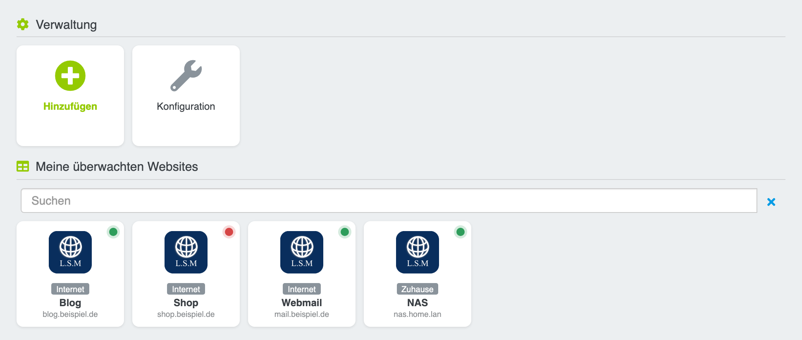
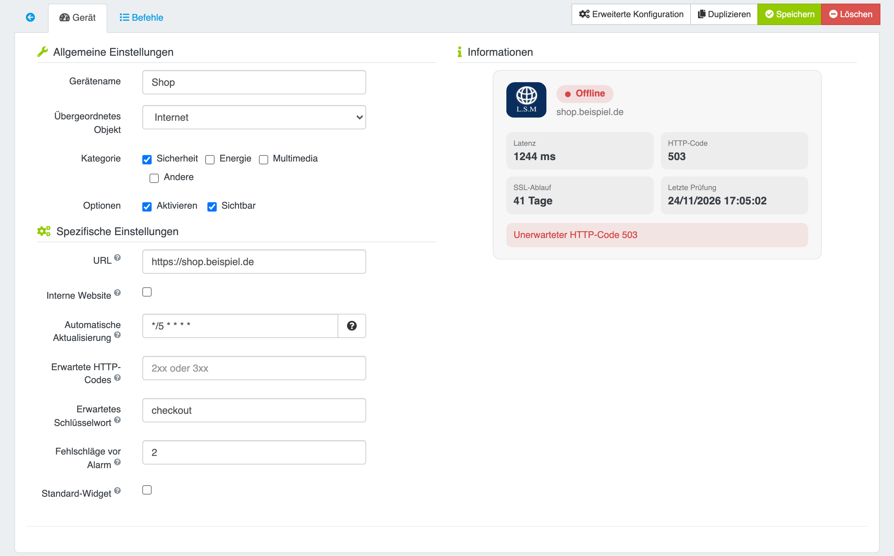
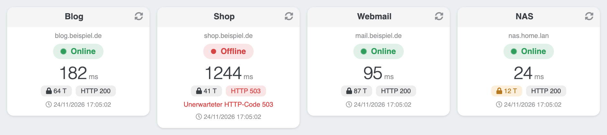

# Plugin Lite Site Monitoring

Lite Site Monitoring überwacht Ihre Websites aus Jeedom: Es zeigt an, ob sie online sind, misst ihre Antwortzeiten, prüft den HTTP-Code und auf Wunsch, ob ein Schlüsselwort auf der Seite vorhanden ist. Außerdem verfolgt es den Ablauf der SSL-Zertifikate.

## Installation

Installieren Sie das Plugin aus dem Market und aktivieren Sie es. Es sind keine Abhängigkeiten nötig.

Voraussetzung: Jeedom 4.2 oder höher.

## Eine Website hinzufügen

Öffnen Sie *Plugins > Monitoring > Lite Site Monitoring* und klicken Sie auf **Hinzufügen**. Jede überwachte Website ist ein Gerät. Auf der Plugin-Seite zeigt eine Leuchte den Zustand jeder Website: grün online, rot offline, grau nie geprüft.

## Konfiguration eines Geräts

| Parameter | Beschreibung |
|---|---|
| URL | Zu überwachende Adresse (`https://www.beispiel.de`). Ohne Schema wird `http://` verwendet. |
| Interne Website | Für eine Website im lokalen Netzwerk ankreuzen: Sie wird auch geprüft, wenn Jeedom keinen Internetzugang hat. |
| Automatische Aktualisierung | Prüfhäufigkeit (Cron-Ausdruck, mit Assistent). Standardmäßig alle 5 Minuten. |
| Erwartete HTTP-Codes | Als Erfolg gewertete Codes, durch Kommas getrennt (z. B. `200, 301`). Leer: jeder 2xx- oder 3xx-Code. |
| Erwartetes Schlüsselwort | Text, der auf der Seite stehen muss (Groß-/Kleinschreibung egal). Erkennt eine Fehlerseite, die mit Code 200 ausgeliefert wird. |
| Fehlschläge vor Alarm | Anzahl aufeinanderfolgender fehlgeschlagener Prüfungen, bevor die Website als offline gilt. Standardmäßig 1. |
| Standard-Widget | Verwendet die Standardanzeige von Jeedom statt des Plugin-Widgets. |

Der Bereich **Informationen** fasst die letzte Prüfung zusammen: Zustand, Latenz, HTTP-Code, Tage bis zum Ablauf des Zertifikats, Datum der Prüfung und Ursache eines Fehlschlags.

## Funktionsweise

- Gleichzeitig fällige Websites werden **parallel** geprüft. Jede Anfrage folgt Weiterleitungen und ist auf 20 Sekunden begrenzt.
- Eine fehlgeschlagene Prüfung wird **sofort einmal wiederholt**, um vorübergehende Fehler auszuschließen. Mit **Fehlschläge vor Alarm** ab 2 gilt die Website erst nach so vielen aufeinanderfolgenden Fehlschlägen als offline.
- Hat Jeedom **keinen Internetzugang**, werden nicht interne Websites nicht geprüft: Ihr letzter Zustand bleibt erhalten und der Befehl **Internetzugang** wechselt auf 0. Ein Internetausfall löst also nicht für alle Websites einen Alarm aus.
- Das SSL-Zertifikat wird für die Verfügbarkeit nicht geprüft: Ein selbstsigniertes Zertifikat macht die Website nicht offline. Sein Ablauf wird mit dem Befehl **SSL-Ablauf** verfolgt.

## Befehle

| Befehl | Typ | Beschreibung |
|---|---|---|
| Aktualisieren | Aktion | Startet sofort eine Prüfung. |
| Online | Binäre Info, protokolliert | 1, wenn die Website wie erwartet antwortet, 0, wenn sie offline ist. |
| Latenz | Numerische Info (ms), protokolliert | Gesamtdauer der Anfrage. |
| DNS-Auflösung, TCP-Verbindung, SSL-Handshake, TTFB | Numerische Info (ms) | Kumulierte Zeiten ab Beginn der Anfrage: DNS-Auflösung, TCP-Verbindung, TLS-Handshake, erstes empfangenes Byte. |
| HTTP-Code | Numerische Info | Endgültiger HTTP-Code (0 ohne Antwort). |
| Fehler | Text-Info | Ursache des letzten Fehlschlags, bei Erfolg leer. |
| SSL-Ablauf | Numerische Info (Tage) | Tage bis zum Ablauf des Zertifikats (nur HTTPS-Websites). |
| Internetzugang | Binäre Info | Ergebnis des letzten Internetzugangstests von Jeedom. |
| Letzte Prüfung | Text-Info | Datum der letzten Prüfung. |

Die Befehlsnamen werden beim Anlegen des Geräts in der Sprache von Jeedom vergeben. Mit einer früheren Version angelegte Geräte behalten ihre alten Namen (OnLine, DNS Resolution, TCP, SSL, Maj).

Szenario-Beispiel: Auslöser `#[Internet][Shop][Online]#`, Bedingung `#[Internet][Shop][Online]# == 0`, Aktion: Benachrichtigung mit dem Befehl **Fehler**. Um vor dem Ablauf eines Zertifikats gewarnt zu werden: Bedingung `#[Internet][Shop][SSL-Ablauf]# < 15`.

## Widget

Das Widget zeigt den Zustand, die Latenz, die verbleibenden Tage bis zum Ablauf des Zertifikats (orange unter 30 Tagen, rot unter 7), den HTTP-Code, die Ursache eines Fehlschlags und das Datum der letzten Prüfung. Das Symbol oben rechts startet eine Prüfung.

## FAQ

**Eine Website ist offline, obwohl sie im Browser lädt**: Sehen Sie sich den Befehl **Fehler** an. Ein unerwarteter HTTP-Code (z. B. 403, wenn die Website Bots sperrt) kann unter **Erwartete HTTP-Codes** eingetragen werden.

**Meine internen Websites gehen bei Internetausfall offline**: Kreuzen Sie bei diesen Geräten **Interne Website** an.

**Die angezeigten Zeiten sind anders als vorher**: Seit Version 1.0.0 sind die Zeiten in Millisekunden und die Latenz entspricht der Gesamtdauer der Anfrage. Der alte Verlauf dieser Befehle wird beim Update geleert.
