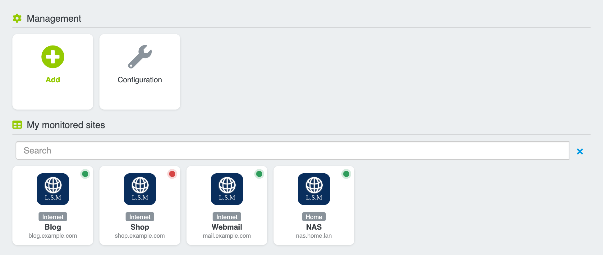
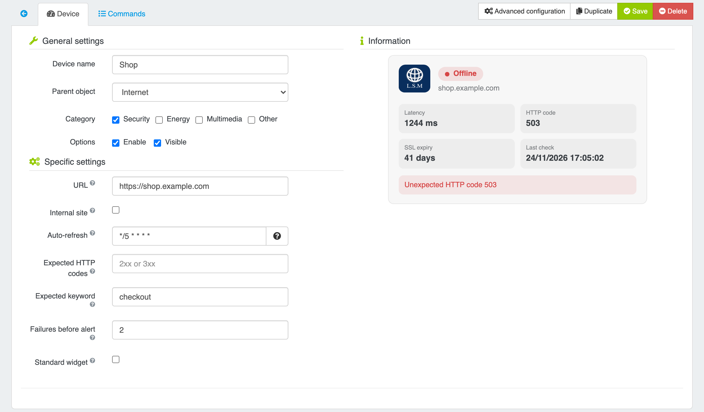
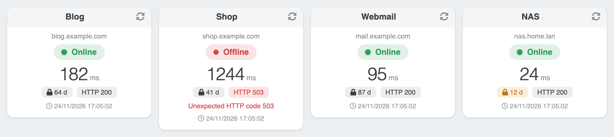

# Lite Site Monitoring plugin

Lite Site Monitoring monitors your websites from Jeedom: it tells you whether they are online, measures their response times, checks the HTTP code and, if you wish, that a keyword is present in the page. It also tracks SSL certificate expiry.

## Installation

Install the plugin from the Market and enable it. No dependency is needed.

Requirement: Jeedom 4.2 or later.

## Adding a site

Open *Plugins > Monitoring > Lite Site Monitoring* and click **Add**. Each monitored site is a device. On the plugin page, a light shows the state of each site: green online, red offline, grey never checked.

## Device configuration

| Setting | Description |
|---|---|
| URL | Address to monitor (`https://www.example.com`). Without a scheme, `http://` is used. |
| Internal site | Tick for a local network site: it is checked even when Jeedom has no Internet access. |
| Auto-refresh | Check frequency (cron expression, with the assistant). Every 5 minutes by default. |
| Expected HTTP codes | Codes considered a success, separated by commas (e.g. `200, 301`). Empty: any 2xx or 3xx code. |
| Expected keyword | Text that must appear in the page (case-insensitive). Detects an error page served with a 200 code. |
| Failures before alert | Number of consecutive failed checks before the site is marked offline. 1 by default. |
| Standard widget | Uses the default Jeedom display instead of the plugin widget. |

The **Information** panel summarizes the last check: state, latency, HTTP code, days before the certificate expires, check date and the cause of any failure.

## How it works

- Sites due at the same time are checked **in parallel**. Each request follows redirects and is limited to 20 seconds.
- A failed check is **retried once immediately** to rule out transient errors. With **Failures before alert** set to 2 or more, the site only goes offline after that many failed checks in a row.
- When Jeedom **has no Internet access**, sites that are not internal are not checked: their last state is kept and the **Internet access** command goes to 0. An Internet outage therefore does not raise an alert on every site.
- The SSL certificate is not validated to judge availability: a self-signed certificate does not make the site offline. Its expiry is tracked by the **SSL expiry** command.

## Commands

| Command | Type | Description |
|---|---|---|
| Refresh | Action | Runs a check immediately. |
| Online | Binary info, historized | 1 if the site responds as expected, 0 if it is offline. |
| Latency | Numeric info (ms), historized | Total request time. |
| DNS resolution, TCP connection, SSL handshake, TTFB | Numeric info (ms) | Cumulative times from the start of the request: DNS resolution, TCP connection, TLS handshake, first byte received. |
| HTTP code | Numeric info | Final HTTP code (0 if no response). |
| Error | Text info | Cause of the last failure, empty on success. |
| SSL expiry | Numeric info (days) | Days before the certificate expires (HTTPS sites only). |
| Internet access | Binary info | Result of Jeedom's last Internet access test. |
| Last check | Text info | Date of the last check. |

Command names are given in the Jeedom language when the device is created. Devices created with an earlier version keep their former names (OnLine, DNS Resolution, TCP, SSL, Maj).

Scenario example: trigger `#[Internet][Shop][Online]#`, condition `#[Internet][Shop][Online]# == 0`, action: notification with the **Error** command. To be warned before a certificate expires: condition `#[Internet][Shop][SSL expiry]# < 15`.

## Widget

The widget shows the state, the latency, the days left before the certificate expires (orange under 30 days, red under 7), the HTTP code, the cause of a failure and the date of the last check. The icon at the top right runs a check.

## FAQ

**A site is offline although it loads in my browser**: look at the **Error** command. An unexpected HTTP code (403, for example, if the site blocks bots) can be added to **Expected HTTP codes**.

**My internal sites go offline when the Internet is down**: tick **Internal site** on these devices.

**The displayed times are different from before**: since version 1.0.0, times are in milliseconds and the latency is the total request time. The former history of these commands is cleared during the update.
