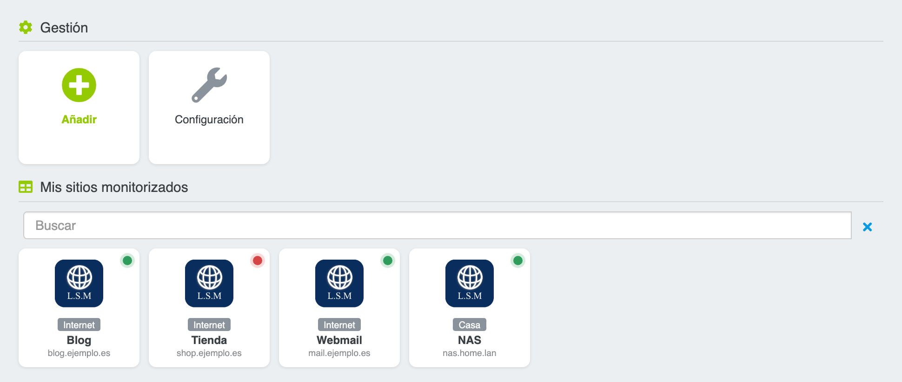
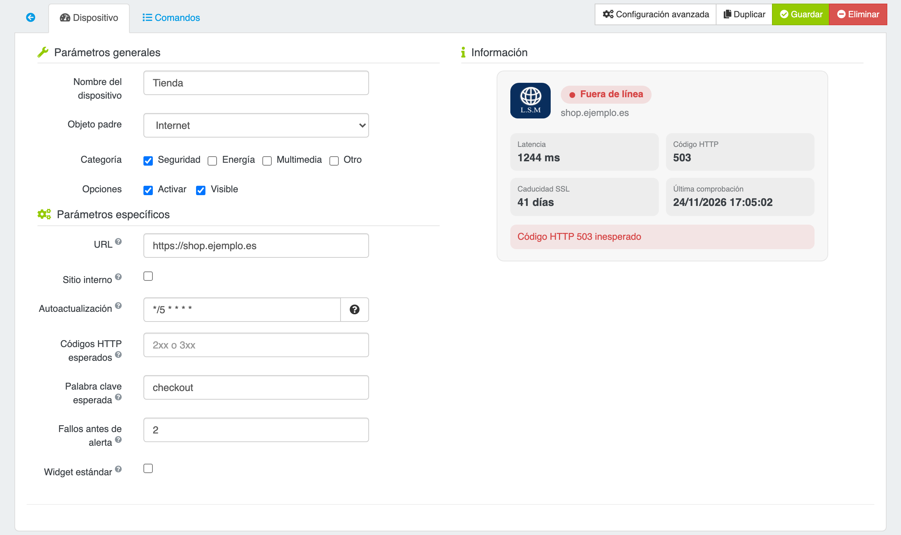
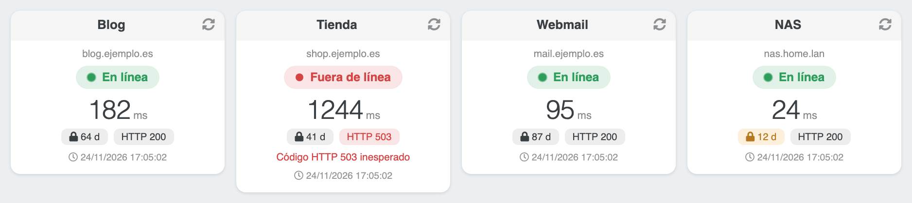

# Plugin Lite Site Monitoring

Lite Site Monitoring supervisa sus sitios web desde Jeedom: indica si están en línea, mide sus tiempos de respuesta, comprueba el código HTTP y, si lo desea, la presencia de una palabra clave en la página. También sigue la caducidad de los certificados SSL.

## Instalación

Instale el plugin desde el Market y actívelo. No necesita ninguna dependencia.

Requisito: Jeedom 4.2 o superior.

## Añadir un sitio

Abra *Plugins > Monitoring > Lite Site Monitoring* y haga clic en **Añadir**. Cada sitio supervisado es un dispositivo. En la página del plugin, un indicador muestra el estado de cada sitio: verde en línea, rojo fuera de línea, gris nunca comprobado.

## Configuración de un dispositivo

| Parámetro | Descripción |
|---|---|
| URL | Dirección a supervisar (`https://www.ejemplo.es`). Sin esquema, se usa `http://`. |
| Sitio interno | Marcar para un sitio de la red local: se comprueba aunque Jeedom no tenga acceso a Internet. |
| Autoactualización | Frecuencia de las comprobaciones (expresión cron, con el asistente). Cada 5 minutos por defecto. |
| Códigos HTTP esperados | Códigos considerados un éxito, separados por comas (p. ej. `200, 301`). Vacío: cualquier código 2xx o 3xx. |
| Palabra clave esperada | Texto que debe aparecer en la página (sin distinguir mayúsculas). Detecta una página de error servida con un código 200. |
| Fallos antes de alerta | Número de comprobaciones fallidas consecutivas antes de marcar el sitio como fuera de línea. 1 por defecto. |
| Widget estándar | Usa la visualización predeterminada de Jeedom en lugar del widget del plugin. |

El recuadro **Información** resume la última comprobación: estado, latencia, código HTTP, días antes de la caducidad del certificado, fecha de la comprobación y causa del fallo, si lo hay.

## Funcionamiento

- Los sitios que tocan a la vez se comprueban **en paralelo**. Cada petición sigue las redirecciones y está limitada a 20 segundos.
- Una comprobación fallida se **repite una vez de inmediato** para descartar errores pasajeros. Con **Fallos antes de alerta** a 2 o más, el sitio solo pasa a fuera de línea tras ese número de fallos seguidos.
- Si Jeedom **no tiene acceso a Internet**, los sitios que no son internos no se comprueban: se conserva su último estado y el comando **Acceso a Internet** pasa a 0. Así, un corte de Internet no genera una alerta en todos los sitios.
- El certificado SSL no se valida para juzgar la disponibilidad: un certificado autofirmado no deja el sitio fuera de línea. Su caducidad se sigue con el comando **Caducidad SSL**.

## Comandos

| Comando | Tipo | Descripción |
|---|---|---|
| Actualizar | Acción | Lanza una comprobación inmediata. |
| En línea | Info binaria, historizada | 1 si el sitio responde como se espera, 0 si está fuera de línea. |
| Latencia | Info numérica (ms), historizada | Tiempo total de la petición. |
| Resolución DNS, Conexión TCP, Negociación SSL, TTFB | Info numérica (ms) | Tiempos acumulados desde el inicio de la petición: resolución DNS, conexión TCP, negociación TLS, primer byte recibido. |
| Código HTTP | Info numérica | Código HTTP final (0 si no hay respuesta). |
| Error | Info texto | Causa del último fallo, vacío en caso de éxito. |
| Caducidad SSL | Info numérica (días) | Días antes de la caducidad del certificado (solo sitios HTTPS). |
| Acceso a Internet | Info binaria | Resultado de la última prueba de acceso a Internet de Jeedom. |
| Última comprobación | Info texto | Fecha de la última comprobación. |

Los nombres de los comandos se dan en el idioma de Jeedom al crear el dispositivo. Los dispositivos creados con una versión anterior conservan sus nombres antiguos (OnLine, DNS Resolution, TCP, SSL, Maj).

Ejemplo de escenario: disparador `#[Internet][Tienda][En línea]#`, condición `#[Internet][Tienda][En línea]# == 0`, acción: notificación con el comando **Error**. Para recibir un aviso antes de que caduque un certificado: condición `#[Internet][Tienda][Caducidad SSL]# < 15`.

## Widget

El widget muestra el estado, la latencia, los días que quedan antes de la caducidad del certificado (naranja por debajo de 30 días, rojo por debajo de 7), el código HTTP, la causa de un fallo y la fecha de la última comprobación. El icono de arriba a la derecha lanza una comprobación.

## Preguntas frecuentes

**Un sitio está fuera de línea aunque se muestra en mi navegador**: mire el comando **Error**. Un código HTTP inesperado (403, por ejemplo, si el sitio bloquea los robots) puede añadirse en **Códigos HTTP esperados**.

**Mis sitios internos pasan a fuera de línea cuando se corta Internet**: marque **Sitio interno** en esos dispositivos.

**Los tiempos mostrados son distintos de antes**: desde la versión 1.0.0, los tiempos están en milisegundos y la latencia corresponde al tiempo total de la petición. El historial anterior de estos comandos se vacía durante la actualización.
