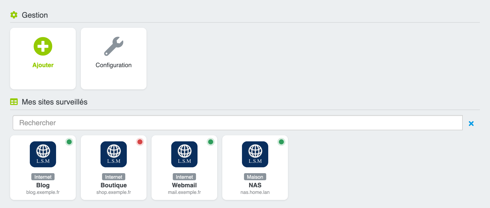
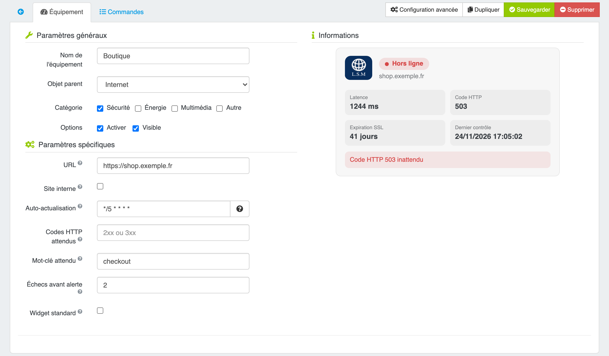
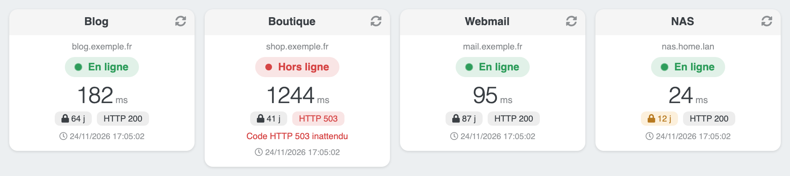

# Plugin Lite Site Monitoring

Lite Site Monitoring surveille vos sites web depuis Jeedom : il indique s'ils sont en ligne, mesure leurs temps de réponse, vérifie le code HTTP et, si vous le souhaitez, la présence d'un mot-clé dans la page. Il suit aussi l'expiration des certificats SSL.

## Installation

Installez le plugin depuis le Market puis activez-le. Aucune dépendance n'est nécessaire.

Prérequis : Jeedom 4.2 ou supérieur.

## Ajouter un site

Ouvrez *Plugins > Monitoring > Lite Site Monitoring* et cliquez sur **Ajouter**. Chaque site surveillé est un équipement. Sur la page du plugin, un voyant indique l'état de chaque site : vert en ligne, rouge hors ligne, gris jamais contrôlé.

## Configuration d'un équipement

| Paramètre | Description |
|---|---|
| URL | Adresse à surveiller (`https://www.exemple.fr`). Sans schéma, `http://` est utilisé. |
| Site interne | À cocher pour un site du réseau local : il est contrôlé même si Jeedom n'a pas accès à Internet. |
| Auto-actualisation | Fréquence des contrôles (expression cron, avec l'assistant). Toutes les 5 minutes par défaut. |
| Codes HTTP attendus | Codes considérés comme un succès, séparés par des virgules (ex. `200, 301`). Vide : tout code 2xx ou 3xx. |
| Mot-clé attendu | Texte qui doit figurer dans la page (casse ignorée). Permet de détecter une page d'erreur servie avec un code 200. |
| Échecs avant alerte | Nombre de contrôles consécutifs en échec avant de passer le site hors ligne. 1 par défaut. |
| Widget standard | Utilise l'affichage Jeedom par défaut au lieu du widget du plugin. |

Le cadre **Informations** résume le dernier contrôle : état, latence, code HTTP, jours avant l'expiration du certificat, date du contrôle et cause de l'échec éventuel.

## Fonctionnement

- Les sites à contrôler au même moment sont interrogés **en parallèle**. Chaque requête suit les redirections et est limitée à 20 secondes.
- Un contrôle en échec est **relancé une fois immédiatement**, pour écarter les erreurs passagères. Avec **Échecs avant alerte** à 2 ou plus, le site ne passe hors ligne qu'après autant de contrôles en échec à la suite.
- Si Jeedom **n'a plus accès à Internet**, les sites qui ne sont pas internes ne sont pas contrôlés : leur dernier état est conservé et la commande **Accès Internet** passe à 0. Une coupure de la box ne déclenche donc pas d'alerte sur tous les sites.
- Le certificat SSL n'est pas vérifié pour juger de la disponibilité : un certificat auto-signé ne rend pas le site hors ligne. Son expiration est suivie par la commande **Expiration SSL**.

## Commandes

| Commande | Type | Description |
|---|---|---|
| Rafraîchir | Action | Lance un contrôle immédiat. |
| En ligne | Info binaire, historisée | 1 si le site répond comme attendu, 0 s'il est hors ligne. |
| Latence | Info numérique (ms), historisée | Temps total de la requête. |
| Résolution DNS, Connexion TCP, Négociation SSL, TTFB | Info numérique (ms) | Temps cumulés depuis le début de la requête : résolution DNS, connexion TCP, négociation TLS, premier octet reçu. |
| Code HTTP | Info numérique | Code HTTP final (0 si aucune réponse). |
| Erreur | Info texte | Cause du dernier échec, vide en cas de succès. |
| Expiration SSL | Info numérique (jours) | Nombre de jours avant l'expiration du certificat (sites HTTPS uniquement). |
| Accès Internet | Info binaire | Résultat du dernier test d'accès à Internet de Jeedom. |
| Dernier contrôle | Info texte | Date du dernier contrôle. |

Les noms des commandes sont donnés dans la langue de Jeedom à la création de l'équipement. Les équipements créés avec une version précédente gardent leurs anciens noms (OnLine, DNS Resolution, TCP, SSL, Maj).

Exemple de scénario : déclencheur `#[Internet][Boutique][En ligne]#`, condition `#[Internet][Boutique][En ligne]# == 0`, action : notification avec la commande **Erreur**. Pour être prévenu avant l'expiration d'un certificat : condition `#[Internet][Boutique][Expiration SSL]# < 15`.

## Widget

Le widget affiche l'état, la latence, les jours restants avant l'expiration du certificat (orange sous 30 jours, rouge sous 7), le code HTTP, la cause d'un échec et la date du dernier contrôle. L'icône en haut à droite relance un contrôle.

## FAQ

**Un site est hors ligne alors qu'il s'affiche dans mon navigateur** : regardez la commande **Erreur**. Un code HTTP inattendu (403, par exemple, si le site bloque les robots) peut être ajouté dans **Codes HTTP attendus**.

**Mes sites internes passent hors ligne quand Internet est coupé** : cochez **Site interne** sur ces équipements.

**Les temps affichés sont différents d'avant** : depuis la version 1.0.0, les temps sont en millisecondes et la latence correspond au temps total de la requête. L'ancien historique de ces commandes est vidé à la mise à jour.
