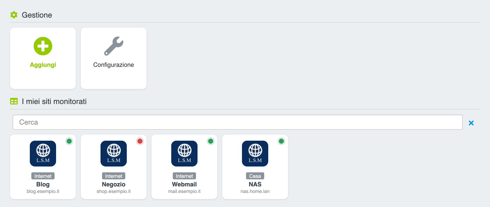
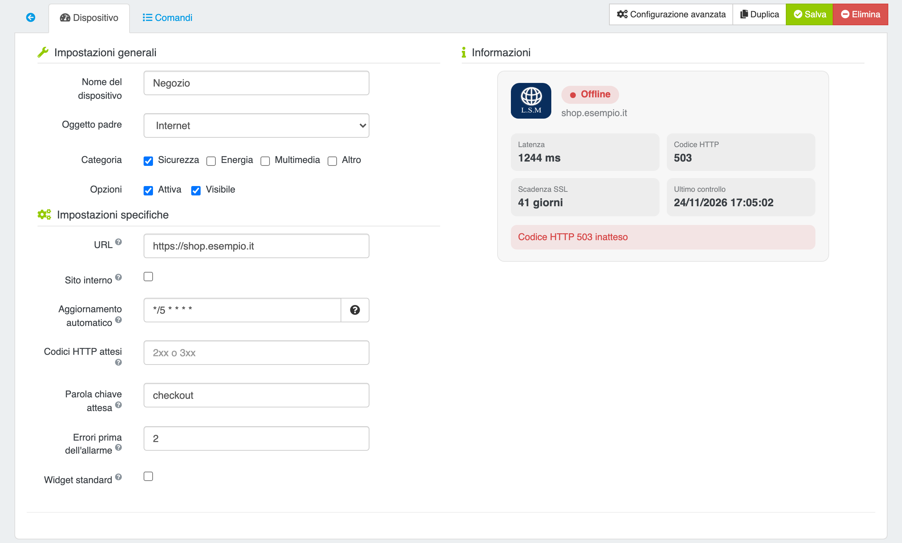
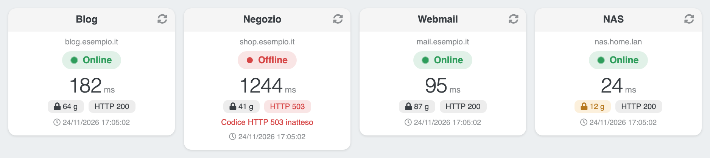

# Plugin Lite Site Monitoring

Lite Site Monitoring sorveglia i tuoi siti web da Jeedom: indica se sono online, misura i tempi di risposta, verifica il codice HTTP e, se lo desideri, la presenza di una parola chiave nella pagina. Segue anche la scadenza dei certificati SSL.

## Installazione

Installa il plugin dal Market e attivalo. Non serve alcuna dipendenza.

Requisito: Jeedom 4.2 o superiore.

## Aggiungere un sito

Apri *Plugins > Monitoring > Lite Site Monitoring* e clicca su **Aggiungi**. Ogni sito monitorato è un dispositivo. Nella pagina del plugin, una spia indica lo stato di ogni sito: verde online, rosso offline, grigio mai controllato.

## Configurazione di un dispositivo

| Parametro | Descrizione |
|---|---|
| URL | Indirizzo da monitorare (`https://www.esempio.it`). Senza schema, viene usato `http://`. |
| Sito interno | Da spuntare per un sito della rete locale: viene controllato anche se Jeedom non ha accesso a Internet. |
| Aggiornamento automatico | Frequenza dei controlli (espressione cron, con l'assistente). Ogni 5 minuti per impostazione predefinita. |
| Codici HTTP attesi | Codici considerati un successo, separati da virgole (es. `200, 301`). Vuoto: qualsiasi codice 2xx o 3xx. |
| Parola chiave attesa | Testo che deve comparire nella pagina (maiuscole e minuscole ignorate). Rileva una pagina di errore servita con codice 200. |
| Errori prima dell'allarme | Numero di controlli consecutivi falliti prima di segnare il sito come offline. 1 per impostazione predefinita. |
| Widget standard | Usa la visualizzazione predefinita di Jeedom al posto del widget del plugin. |

Il riquadro **Informazioni** riassume l'ultimo controllo: stato, latenza, codice HTTP, giorni prima della scadenza del certificato, data del controllo e causa dell'eventuale errore.

## Funzionamento

- I siti da controllare nello stesso momento vengono interrogati **in parallelo**. Ogni richiesta segue i reindirizzamenti ed è limitata a 20 secondi.
- Un controllo fallito viene **ripetuto subito una volta**, per escludere gli errori passeggeri. Con **Errori prima dell'allarme** a 2 o più, il sito passa offline solo dopo altrettanti controlli falliti di seguito.
- Se Jeedom **non ha accesso a Internet**, i siti non interni non vengono controllati: il loro ultimo stato viene mantenuto e il comando **Accesso a Internet** passa a 0. Un'interruzione di Internet non genera quindi un allarme su tutti i siti.
- Il certificato SSL non viene validato per giudicare la disponibilità: un certificato autofirmato non rende il sito offline. La sua scadenza è seguita dal comando **Scadenza SSL**.

## Comandi

| Comando | Tipo | Descrizione |
|---|---|---|
| Aggiorna | Azione | Avvia subito un controllo. |
| Online | Info binaria, storicizzata | 1 se il sito risponde come previsto, 0 se è offline. |
| Latenza | Info numerica (ms), storicizzata | Tempo totale della richiesta. |
| Risoluzione DNS, Connessione TCP, Negoziazione SSL, TTFB | Info numerica (ms) | Tempi cumulativi dall'inizio della richiesta: risoluzione DNS, connessione TCP, negoziazione TLS, primo byte ricevuto. |
| Codice HTTP | Info numerica | Codice HTTP finale (0 se nessuna risposta). |
| Errore | Info testo | Causa dell'ultimo errore, vuota in caso di successo. |
| Scadenza SSL | Info numerica (giorni) | Giorni prima della scadenza del certificato (solo siti HTTPS). |
| Accesso a Internet | Info binaria | Risultato dell'ultimo test di accesso a Internet di Jeedom. |
| Ultimo controllo | Info testo | Data dell'ultimo controllo. |

I nomi dei comandi sono dati nella lingua di Jeedom alla creazione del dispositivo. I dispositivi creati con una versione precedente mantengono i vecchi nomi (OnLine, DNS Resolution, TCP, SSL, Maj).

Esempio di scenario: trigger `#[Internet][Negozio][Online]#`, condizione `#[Internet][Negozio][Online]# == 0`, azione: notifica con il comando **Errore**. Per essere avvisati prima della scadenza di un certificato: condizione `#[Internet][Negozio][Scadenza SSL]# < 15`.

## Widget

Il widget mostra lo stato, la latenza, i giorni rimanenti prima della scadenza del certificato (arancione sotto i 30 giorni, rosso sotto i 7), il codice HTTP, la causa di un errore e la data dell'ultimo controllo. L'icona in alto a destra avvia un controllo.

## FAQ

**Un sito è offline anche se si apre nel mio browser**: guarda il comando **Errore**. Un codice HTTP inatteso (403, ad esempio, se il sito blocca i robot) può essere aggiunto in **Codici HTTP attesi**.

**I miei siti interni passano offline quando Internet è interrotto**: spunta **Sito interno** su questi dispositivi.

**I tempi visualizzati sono diversi da prima**: dalla versione 1.0.0 i tempi sono in millisecondi e la latenza corrisponde al tempo totale della richiesta. Il vecchio storico di questi comandi viene svuotato durante l'aggiornamento.
